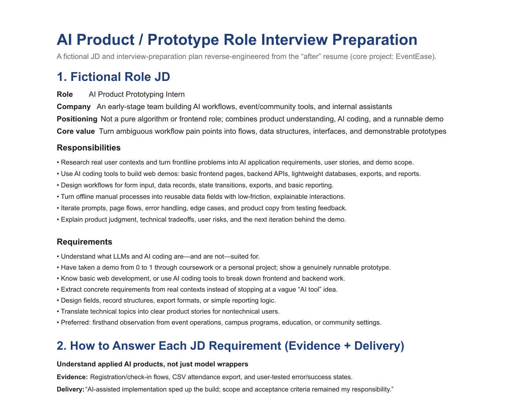
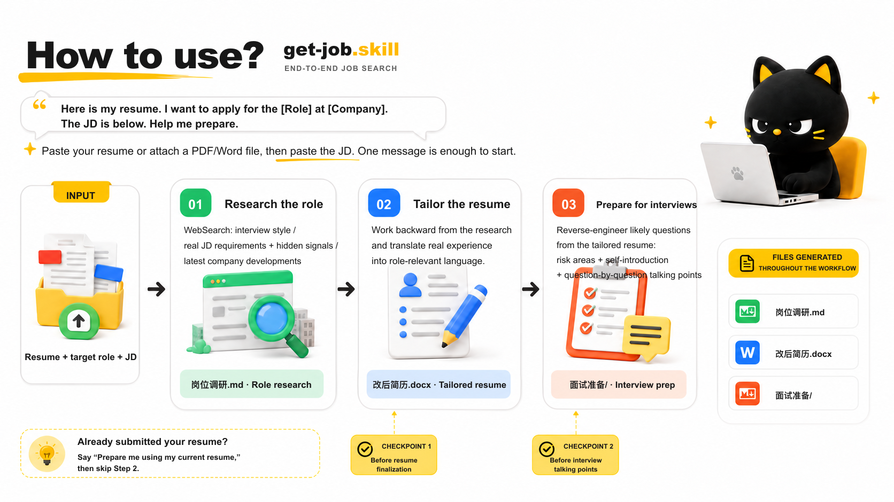

<div align="center">

# get-job.skill


<h3>From role research and resume tailoring to round-by-round interview preparation, translate your real experience into the language interviewers understand.</h3>

[](LICENSE)
[](https://github.com/agentenatalie/get-job.skill/actions/workflows/quality.yml)
[](https://agentskills.io)
[](#installation)

**Your end-to-end job-search skill**

[简体中文](README.md) · **English**

[What It Does](#what-it-does) · [Before & After](#before--after) · [How to Use](#how-to-use) · [Example Deliverables](#example-deliverables) · [How It Works](#how-it-works) · [Installation](#installation)

</div>

---

## What It Does

The hardest part of job searching is often that **your experience looks unrelated to the role you want**, or that **a polished resume falls apart as soon as an interviewer asks follow-up questions**. This skill handles the entire workflow, with every stage feeding the next:

| Stage | What it does | Output |
| ----- | ------------ | ------ |
| **① Research the role** | Selects local sources for the target market, then uses WebSearch and source-quality tiers to uncover what the role really requires: core capability keywords, hidden requirements, and recent developments | `岗位调研.md` |
| **② Tailor the resume** | Works backward from the target role, translates real experience into role-relevant language, uses transferable-skill narratives sparingly, and generates a formatted `.docx` | `改后简历.docx` |
| **③ Prepare for interviews** | Identifies the actual interview stages through research, drills into every resume bullet, trains delivery and self-introduction, and builds a post-interview review question bank so the story holds up under follow-up questions | `面试准备/` |

Before starting, it runs an **input health check**: whether the target role, target market, JD, resume, application status, and interview stage are complete; which gaps can be filled automatically; and which ones require a lower-confidence fallback. If the JD is missing, it first looks for an official careers page or a comparable listing. If the interview stages are unclear, it produces only an overview and a bullet-by-bullet drill-down. If the resume input is incomplete, it returns a list of missing evidence instead of inventing information.

Before delivery, it also runs a **quality gate** covering source coverage, JD-to-resume alignment, resume-bullet-to-interview-prep coverage, the evidence level behind every claim, the basis for each interview stage, and internal labels that should not appear in public files. Hard failures block delivery. Anything that can be safely downgraded is clearly marked, and anything that cannot be verified is labeled low confidence.

Every output becomes an input to the next stage. **If the positioning is wrong, a beautifully rewritten resume still will not help.**

An education major can target finance. A psychology major can move into AI. A humanities student can work in digital operations. The answer is not invented experience. It is translation.

---

## Before & After

The same fictional candidate's resume, before and after. Both versions use one fixed fact baseline, and every claim in the tailored version maps back to a source-fact ID. No unsupported degree, date, GPA, honor, metric, deployment, or production claim is added.

<table>
<tr>
<td width="50%" align="center"><b>❌ Before</b><br/><sub>Action-heavy wording, no clear positioning, and no visible connection to the target role</sub></td>
<td width="50%" align="center"><b>✅ After</b><br/><sub>Positioning statement + pain point → product decision → demo-ready prototype + consistent professional formatting</sub></td>
</tr>
<tr>
<td></td>
<td></td>
</tr>
</table>

> Follow the complete evidence chain in [`examples/en/ai-product-prototyping/`](examples/en/ai-product-prototyping/): source facts → fictional composite JD and role research → before/after resume data → interview preparation.

From there, the skill uses the tailored resume to generate **round-by-round, bullet-by-bullet interview preparation**:

<div align="center">

</div>

> The complete interview-preparation set is available in [`examples/en/ai-product-prototyping/interview-prep/`](examples/en/ai-product-prototyping/interview-prep/).

**That is what this skill does: it translates what you have already done without inventing experience, then prepares you to explain it precisely when the interview gets specific.**

---

## How to Use

<div align="center">

</div>

After installing the skill, **paste your resume and target role directly into the conversation**. One message is enough:

> Here is my resume: `[paste the text or attach a PDF/Word file]`. I want to apply for `[Role]` at `[Company]`. Here is the JD: `[paste the JD]`. Help me prepare.

It will automatically run three stages and generate files throughout the workflow:

1. **Research the role** — Identifies the target country or region, then searches local job boards, interview-experience sources, and official sources for core capabilities, hidden requirements, and recent developments. It also records source coverage → `岗位调研.md`
2. **Tailor the resume** — Works backward from the research findings, translates your real experience into the language of the role, and generates a professionally formatted resume → `改后简历.docx`
3. **Prepare for interviews** — Uses the research and tailored resume to identify the actual interview stages and what each one evaluates. It first prepares explanations, follow-up questions, evidence, and fallback answers for every bullet, then adds self-introduction, delivery training, and a post-interview review question bank → `面试准备/`

When information is incomplete, it does not fill the gaps by making things up. It first searches for or infers what can be recovered automatically; anything unresolved is marked “low confidence” or “needs confirmation” and handled with a reduced-scope output.

There are key confirmation points before the resume is finalized, after the bullet-by-bullet drill-down, after delivery and self-introduction preparation, and before round-specific talking points are written. You review whether the material is accurate before the workflow continues.

Before delivery, the skill runs its quality gates and coverage-matrix checks. If the resume has already been submitted and can no longer be changed, simply say, “Prepare me for the interview based on my current resume,” and it will skip Stage 2.

---

## Example Deliverables

The English flagship is a complete US-English adaptation, not a line-by-line translation of a Chinese example. It uses a fixed fictional fact ledger so the resume and interview materials stay internally consistent. The additional China-market examples remain in Chinese and are labeled accordingly.

| Example | Market / language | What to look for |
| ------- | ----------------- | ---------------- |
| [Business/Communication → AI Product Prototyping](examples/en/ai-product-prototyping/) | United States / English | **Complete traceable example:** source-fact ledger, fictional composite JD, role research, before/after resume data, and six interview-preparation files |
| [Humanities → Digital Operations](examples/文科生投运营/) | China / Chinese | China-market example that translates student activities into operations capabilities |
| [Nontraditional Background → AI Product](examples/非科班投AI产品/) | China / Chinese | China-market example that audits unsupported claims, then removes, qualifies, or prepares transparent explanations for them |

Inside the English flagship:

```text
examples/en/ai-product-prototyping/
├── source-facts.md
├── role-research.md
├── resume-before.json
├── resume-after.json
└── interview-prep/
    ├── 00-overview.md
    ├── 01-resume-bullet-deep-dives.md
    ├── 02-delivery-and-self-introduction.md
    ├── 03-ai-product-prototyping-resume-deep-dive.md
    ├── 04-business-and-product-judgment.md
    └── 99-post-interview-review.md
```

---

## Repository Structure

```text
get-job/
├── SKILL.md                      # Main three-stage workflow, read by the skill runtime
├── references/
│   ├── reliability-playbook.md   # Input checks, automatic gap-filling, and fallback strategies
│   ├── resume-playbook.md        # Target positioning and transferable-skill translation
│   ├── interview-playbook.md     # Stage map, bullet drills, delivery training, evidence audits, and review bank
│   ├── quality-gates.md          # Pre-delivery P0/P1/P2 checks and coverage matrices
│   └── regression-evals.md       # Cross-market, missing-JD, submitted-resume, and inflated-claim scenarios
├── scripts/
│   ├── generate_resume.py        # Renders tailored content into a consistent `.docx` template
│   ├── quality_check.py          # Scans public deliverables for structural issues and prohibited terms
│   ├── sample_resume.json        # Chinese sample input
│   ├── sample_resume.en.json     # English sample input
│   ├── test_scripts.py           # Chinese/English regression tests
│   ├── README.md                 # Chinese script documentation
│   └── README_EN.md              # English script documentation
├── assets/                       # README images
└── examples/                     # Complete fictionalized deliverables
    ├── en/ai-product-prototyping/
    ├── 文科投AICoding/
    ├── 文科生投运营/
    └── 非科班投AI产品/
```

---

## How It Works

### Core Belief: Translate, Do Not Fabricate

The most common resume mistakes are **keyword stuffing** and **listing experience chronologically without positioning**, leaving recruiters to find the connection themselves. They will not. This skill follows five principles:

1. **Work backward from the target role** — Start with the JD and identify the three to five core capabilities the role is really hiring for.
2. **Translate transferable capabilities** — Reframe real experience in the language of the target role. When the career transition is substantial, make the transferable connection briefly and naturally instead of attaching a transfer sentence to every section.
3. **Prepare every bullet for the actual interview stages** — Interviewers often follow a resume bullet two or three levels deep. Prepare the explanation, context, role, actions, measurement logic, follow-up questions, and fallback answer for every bullet. Also prepare a confident, grounded self-introduction, project scripts, and a post-interview review question bank. Stage-specific files are generated only for stages confirmed by the user or found through high-confidence WebSearch.
4. **Handle incomplete input with graceful fallbacks** — When the JD, market, interview stages, source coverage, or resume details are incomplete, fill what can be recovered automatically and reduce the scope of the remaining output instead of sending every exception back to the user.
5. **Run quality gates before delivery** — Use P0/P1/P2 standards and coverage matrices to check sources, JD alignment, bullet coverage, evidence behind claims, the basis for each interview stage, and prohibited terms in public files. If it does not pass, it is not delivered.

### Honesty Guardrails

- **Translation ≠ fabrication**: Reframing something you actually did is translation. Claiming something you never did is fabrication, and it will fall apart under follow-up questions.
- **Every transferable skill needs a real anchor**: Each claimed capability must connect to something you genuinely did.
- **Guardrails are not guarantees**: The skill asks for evidence and flags risks, but it cannot independently prove that every user-provided claim is truthful. A claim without supporting detail cannot be presented as a strong fact.
- **Admitting uncertainty ≠ lying**: “I do not remember the exact calculation method” is an honest boundary, not permission to invent a new answer.
- **Background-check facts are untouchable**: Education, employment dates, and job titles cannot be altered.
- **Built with AI assistance can be a strength**: Honest disclosure is far better than pretending to be a senior engineer and collapsing under technical follow-up questions.

---

## Installation

Built on the open [Agent Skills specification](https://agentskills.io), this skill runs in compatible runtimes including Claude Code, Codex, Cursor, and OpenClaw.

> [!NOTE]
> The English README, flagship example, resume sample, and English resume-rendering labels are localized. The core runtime instructions and reference playbooks remain primarily in Simplified Chinese, so the workflow currently keeps its original output filenames: `岗位调研.md`, `改后简历.docx`, and `面试准备/`.

**Option 1: One command (recommended)**

```bash
npx skills add agentenatalie/get-job.skill
```

**Option 2: Manual installation** — Place the entire `get-job/` directory inside your skills directory:

```bash
# Claude Code
git clone https://github.com/agentenatalie/get-job.skill ~/.claude/skills/get-job
# Codex / other runtimes: place it in the appropriate skills directory
```

**Option 3: Use the methodology as reference material** — If you do not want to install the skill, give the playbooks under `references/` to any AI and ask it to follow the same method when tailoring your resume or preparing you for interviews.

**Usage** — After installation, say:

> “Research `[Company]`'s `[Role]` and tailor this resume for it.” Attach your resume as a PDF or Word file.
>
> Or: “Prepare me for an interview at `[Company]` based on my current resume.” This also works after the resume has already been submitted.

The skill will start with role research and guide you through the complete workflow, producing role research, a tailored resume, and an interview-preparation folder.

---

## License

[CC BY-NC-ND 4.0](LICENSE): You may share this work freely with attribution. **Commercial use and redistribution of modified versions are prohibited.** Contact the author for commercial licensing.

---

## Star History

<div align="center">

<a href="https://www.star-history.com/?repos=agentenatalie%2Fget-job.skill&amp;type=date&amp;legend=top-left">
  <picture>
    <source media="(prefers-color-scheme: dark)" srcset="https://api.star-history.com/chart?repos=agentenatalie/get-job.skill&amp;type=date&amp;theme=dark&amp;legend=top-left&amp;sealed_token=IPQNwoGbipyXKiJOjhGyK6SrdFcSKjaoKamjrvnnvHCSB6MNzeqTQ6OBaX0Lfte5UtF7EDmsBr1nxfw5uzQCCdk8LlnPO8dfNsWPQEiCR8oIspVcaHHqIuAt28UyvoavKQAUSXAJ_n-McpeVM2-Z-vHo2hN0ogJINhKw5ujB8uKl9PfUexEyXnKsSZqL" />
    <source media="(prefers-color-scheme: light)" srcset="https://api.star-history.com/chart?repos=agentenatalie/get-job.skill&amp;type=date&amp;legend=top-left&amp;sealed_token=IPQNwoGbipyXKiJOjhGyK6SrdFcSKjaoKamjrvnnvHCSB6MNzeqTQ6OBaX0Lfte5UtF7EDmsBr1nxfw5uzQCCdk8LlnPO8dfNsWPQEiCR8oIspVcaHHqIuAt28UyvoavKQAUSXAJ_n-McpeVM2-Z-vHo2hN0ogJINhKw5ujB8uKl9PfUexEyXnKsSZqL" />
    
  </picture>
</a>

**If this helps, leave a ⭐ Star so more people tailoring resumes and preparing for interviews can find it.**

</div>
