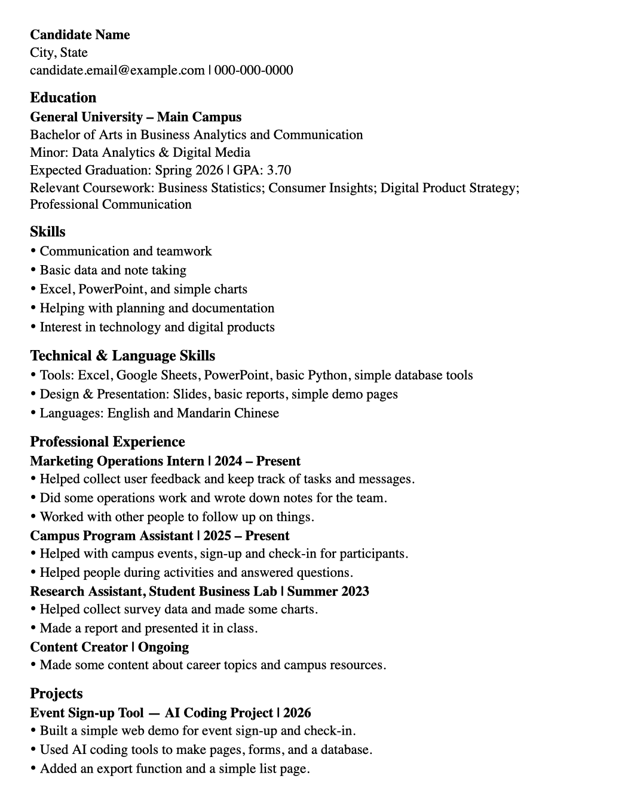
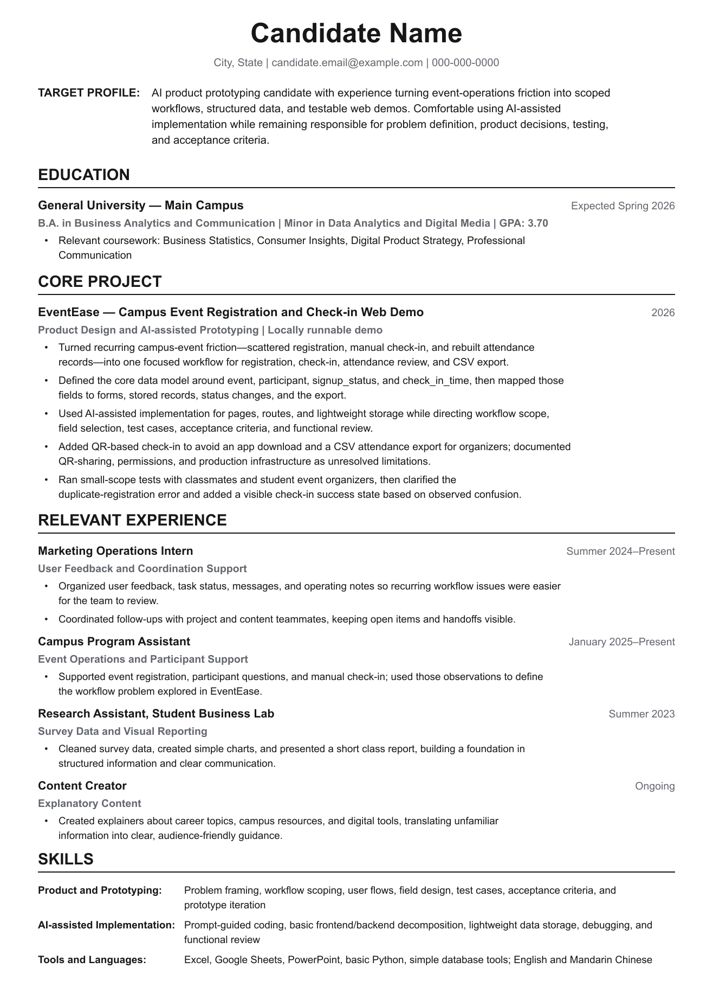

# Example · Business and Communication Background to AI Product Prototyping

> A complete fictional example for a US-English audience: source facts → role research → before/after resume data → bullet-by-bullet and stage-specific interview preparation.

This example demonstrates translation without factual drift. The candidate, company, JD, project, and interview scenario are fictional composites. Every resume and interview claim must trace back to [`source-facts.md`](source-facts.md).

## Files

| File | Purpose |
| --- | --- |
| [`source-facts.md`](source-facts.md) | Fixed candidate facts, fictional composite JD, evidence connections, claim ledger, and prohibited claims |
| [`role-research.md`](role-research.md) | Stage 1 output: input health check, source coverage, target capabilities, alignment, risk map, and inferred interview stages |
| [`resume-before.json`](resume-before.json) | Weak but fact-consistent source resume using the repository's structured resume schema |
| [`resume-after.json`](resume-after.json) | Stage 2 output: targeted US-English resume content using the same facts |
| [`interview-prep/`](interview-prep/) | Stage 3 output: overview, every-bullet deep dives, delivery practice, two inferred-stage files, and a review bank |

## What changed

<table>
<tr>
<td width="50%" align="center"><b>Before</b><br/><sub>Facts are present, but the positioning is generic.</sub></td>
<td width="50%" align="center"><b>After</b><br/><sub>The same facts are organized around AI product prototyping.</sub></td>
</tr>
<tr>
<td></td>
<td></td>
</tr>
</table>

The before version contains the evidence, but hides it behind generic language:

```text
Event Sign-up Tool — AI Coding Project
- Built a locally runnable web demo for event sign-up and check-in.
- Used AI coding tools to make pages, forms, routes, and lightweight data storage.
- Added a participant list and CSV attendance export.
```

The tailored version makes the product reasoning and evidence boundary visible:

```text
EventEase — Campus Event Registration and Check-in Web Demo
Product Design and AI-assisted Prototyping | Locally runnable demo

- Turned recurring campus-event friction into one focused workflow for
  registration, check-in, attendance review, and CSV export.
- Defined event, participant, signup_status, and check_in_time, then mapped
  the fields to forms, stored records, status changes, and the export.
- Used AI-assisted implementation while remaining responsible for workflow
  scope, field selection, test cases, acceptance criteria, and review.
```

The rewrite adds specificity from the fact ledger. It does not add a new degree, date, GPA, honor, course grade, user count, performance metric, deployment, or production claim.

## Interview-preparation set

| File | Use |
| --- | --- |
| [`00-overview.md`](interview-prep/00-overview.md) | Three-message summary, interview-stage map, risk map, and resume-bullet coverage |
| [`01-resume-bullet-deep-dives.md`](interview-prep/01-resume-bullet-deep-dives.md) | A defensible explanation, follow-ups, and evidence boundary for every tailored resume bullet |
| [`02-delivery-and-self-introduction.md`](interview-prep/02-delivery-and-self-introduction.md) | Speaking posture, 45-second introduction, keyword card, project walkthrough, and honest boundary lines |
| [`03-ai-product-prototyping-resume-deep-dive.md`](interview-prep/03-ai-product-prototyping-resume-deep-dive.md) | High-confidence inferred stage focused on the demo, AI-assistance boundary, and technical explanation |
| [`04-business-and-product-judgment.md`](interview-prep/04-business-and-product-judgment.md) | High-confidence inferred stage focused on problem choice, tradeoffs, user risk, and next steps |
| [`99-post-interview-review.md`](interview-prep/99-post-interview-review.md) | A reusable review template and evidence-linked question bank |

## Localization choices

- The target is **AI Product Prototyping Intern**, a clearer international label than a literal translation of “AI Coding.”
- The resume uses US English and a concise target profile while preserving the original education and dates.
- “Built with AI” is expressed as **AI-assisted implementation**. The candidate is responsible for problem definition, workflow scope, fields, testing, acceptance criteria, and review—not independent authorship of every line of code.
- The role and interview stages are explicitly fictional/composite or high-confidence inferred. No real employer process is implied.
- Unsupported claims are removed or bounded; the example does not teach a candidate to evade questions about them.

## Honesty boundary

This repository example is fictional, so its facts are author-defined rather than externally verified. Its teaching value comes from internal consistency: once [`source-facts.md`](source-facts.md) fixes a fact, every downstream file must preserve it. In real use, the candidate must confirm the equivalent facts and provide supporting detail before they become resume claims.
